# Yojana Setu — Voice-Enabled Government Scheme Eligibility Matcher

Smart India Hackathon 2026.

There are thousands of central and state government schemes and no practical way for a citizen
to know which ones apply to them. This project answers that question from a short profile eventually spoken, in any of 13 languages and explains the reasoning behind every result
instead of returning a bare yes or no.

**Status:** working end to end data model, matching engine, API, web app, myScheme scraper,
the voice layer, application assistance and an offline demo mode. 149 schemes are loaded from a
real scrape.

Presenting this? [`DEMO.md`](DEMO.md) is a six-minute script with the exact click order, and
`npm run demo:ready` brings the whole stack up from cold in one command.

---

## Quick start

Requires Node 20.11+ and Docker.

```bash
npm install
npm run setup       # creates .env and apps/web/.env.local from the examples
npm run db:up       # starts PostgreSQL 18 in Docker
npm run db:deploy   # creates tables + the match_schemes() SQL function
npm run db:seed     # loads 18 real schemes and 5 demo applicants
npm run dev         # API on :4000, web app on :3000
```

Before demoing — or after any reboot run the readiness check instead of guessing:

```bash
npm run demo:ready  # starts the DB, verifies migrations, counts schemes, checks the LLM
```

It exits non-zero and names the fix for anything missing. `npm run demo:ready -- --skip-llm`
skips the network probe when the wifi is hostile.

Then open:

| URL                              | What it is                                  |
| -------------------------------- | ------------------------------------------- |
| http://localhost:3000            | Web app                                     |
| http://localhost:4000/api/docs   | Swagger UI for the whole API                |
| http://localhost:4000/api/health | Reports DB, matcher and scheme-count status |

If something on your machine already owns port 3000, set `WEB_PORT` and `CORS_ORIGINS` in `.env`
together the API rejects browser origins it has not been told about.

### Container engine: Docker or podman

The `db:*` scripts go through `scripts/compose.mjs`, which finds whichever container socket
exists and points the Docker CLI at it. Nothing to configure in the common cases:

| Your machine                   | What happens                                                                     |
| ------------------------------ | -------------------------------------------------------------------------------- |
| Docker daemon running          | `/var/run/docker.sock` is used, `DOCKER_HOST` untouched                          |
| Rootless podman                | `DOCKER_HOST` is set to `unix:///run/user/$UID/podman/podman.sock` automatically |
| `DOCKER_HOST` already exported | Respected as-is                                                                  |
| Neither socket present         | Clear error naming the command to start each engine                              |

Podman is a genuine drop-in: its socket speaks the Docker API, so the Docker CLI works against
it unchanged. Enable it once and it survives reboots:

```bash
systemctl --user enable --now podman.socket
```

If you run `docker compose` **directly** rather than through the npm scripts, export the socket
yourself the wrapper cannot help there:

```bash
export DOCKER_HOST=unix:///run/user/$(id -u)/podman/podman.sock   # add to ~/.bashrc
```

To start Docker instead: `sudo systemctl start docker`.

Note that podman does not restore `restart: unless-stopped` containers after a reboot unless
`podman-restart.service` is enabled, so expect to re-run `npm run db:up` after restarting. The
data lives in a named volume and survives.

### Running without containers

Postgres 18 installed natively works too point `DATABASE_URL` at it and skip `db:up`. Only
`db:psql`, `db:logs` and `db:verify` assume a container; for a native cluster run the assertion
suite directly:

```bash
psql "$DATABASE_URL" -v ON_ERROR_STOP=1 -q -o /dev/null -f apps/api/prisma/sql/verify-matching.sql
```
---

## Architecture

```mermaid
flowchart TB
    subgraph client["Browser — Next.js"]
        mic["Microphone<br/>MediaRecorder"]
        form["Typed form<br/>always available"]
        results["Results, with a reason<br/>on every criterion"]
        snap[("demo-snapshot.json<br/>recorded real answers")]
    end

    subgraph api["API — NestJS on :4000"]
        stt["Speech to text<br/>Sarvam Saaras / Whisper"]
        extract["Profile extraction<br/>VOICE_LLM_MODEL"]
        match["MatchingService"]
        assist["Application pack"]
    end

    subgraph db["PostgreSQL 18"]
        fn["match_schemes&#40;&#41;<br/>deterministic SQL"]
        tbl[("schemes<br/>jsonb eligibility")]
    end

    subgraph scraper["Scraper — batch, never in the request path"]
        pw["Playwright → myScheme"]
        norm["Eligibility normaliser<br/>LLM_MODEL"]
    end

    mic --> stt --> extract
    extract -->|"applicant fields only"| match
    form --> match
    match --> fn
    fn --> tbl
    fn --> results
    match --> assist --> results
    snap -. "NEXT_PUBLIC_DEMO_OFFLINE=1" .-> results
    pw --> norm --> tbl
```



The one line worth tracing is the arrow out of **profile extraction**. A language model turns
"main chalis saal ka kisan hoon" into `{ age: 40, occupation: FARMER }` and stops there. It never
sees a scheme, never decides who is eligible, and no scheme data is sent to it. Eligibility is
decided entirely by `match_schemes()`, a SQL function, against rules stored as JSONB so the same
profile always produces the same answer, and every answer can be traced to a row and a rule.

**Two models, on purpose.** The scraper needs `openai/gpt-oss-120b` for strict `json_schema`
support when reading legal prose. Voice extraction is a simpler task in front of a waiting person,
so it runs on `llama-3.3-70b-versatile` in JSON-object mode. Keeping them separate is a latency
requirement rather than a preference: Groq rate-limits **per model**, so a shared model puts a
background scrape and a live demo in the same tokens-per-minute bucket. See
[Latency](#latency-and-why-a-voice-turn-took-74-seconds).


---

## How eligibility matching works

This is the core design decision, so it is worth reading before changing anything.

### One JSONB column, one SQL query

A scheme's rules live in a single `schemes.eligibility` JSONB column, so the scraper can add
schemes with new rule combinations without a migration:

```json
{
  "minAge": 18,
  "maxAge": 40,
  "maxAnnualIncome": 250000,
  "gender": "*",
  "socialCategory": ["SC", "ST"],
  "occupation": ["FARMER"],
  "states": ["IN-BR"],
  "maxLandHolding": 2,
  "requiresDisability": false,
  "isStudentOnly": false
}
```

Matching is a single call to a PostgreSQL function never a loop in application code:

```sql
SELECT * FROM match_schemes(
  '{"age":34,"state":"IN-BR","occupation":"FARMER","annualIncomeLower":100000,"annualIncomeUpper":250000}'::jsonb,
  0     -- max failed criteria: 0 = only real matches, 1 = also near misses
);
```

Two encoding rules make that possible, and they never vary:

1. **Numeric bounds use `null` for "unbounded".** In SQL that becomes
   `COALESCE((eligibility->>'minAge')::int, 0)` an absent bound turns into one that is
   trivially satisfied, so there are no `OR ... IS NULL` branches.
2. **Categorical fields use the wildcard `'*'` for "excludes nobody", and are always present.**
   In SQL that becomes `eligibility->'states' ?| ARRAY['IN-BR','*']` — one containment test
   covers both "this state qualifies" and "no state restriction".

The result is a flat conjunction of cheap predicates rather than a tree of null checks. The
invariant is enforced in three places so it cannot rot: `normalizeEligibility()` in
`@sih/shared`, a `CHECK` constraint on the table, and the seed/import path that must call the
normalizer. Never hand-write this JSON.

### Three outcomes per criterion, not two

Every criterion resolves to `PASS`, `FAIL` or **`UNKNOWN`**.

`UNKNOWN` is what makes a voice-first flow work. A conversation builds a profile gradually, so
"not asked yet" is the normal state — and it must not read as a rejection. A scheme with no
failures but some unknowns is still in play, and the API returns:

- `checks` — the per-criterion verdict map, which the UI renders as the "why" behind a result
- `failedCriteria` / `unverifiedCriteria` — in the order a person would naturally be asked
- `nextQuestion` — the single question that would settle the most schemes, already phrased in
  English and Hindi, with the profile field to write the answer into

That last one is the hand-off point for the voice layer: speak `question`, transcribe into
`field`, re-run the same match call. There is no separate voice code path.

Income deserves a note. Applicants report a _bracket_ (easy to say out loud) while schemes
specify an exact cap. A bracket entirely under the cap passes, one entirely above it fails, and
one that straddles the cap returns `UNKNOWN` with `needsIncomeVerification: true` — the system
asks for an exact figure rather than guessing in either direction.

### Why the rules live in the database

- One round trip regardless of catalogue size no N+1 over rules.
- Every caller (API, a future re-check cron, admin tooling, a `psql` session during the demo)
  evaluates identical logic.
- Postgres evaluates the conjunction per row without materializing every scheme into JS objects.

The criterion primitives (`elig_at_least`, `elig_in_set`, `elig_income_within`, …) are
`LANGUAGE sql IMMUTABLE` single-expression functions specifically so the planner inlines them.
Measured on this schema with `EXPLAIN ANALYZE`: **~1 ms for the 18 seeded schemes and ~40 ms at
5,000** — comfortably inside a conversational turn. Prisma does not manage functions or CHECK constraints, so nothing in the
`matching_engine` migration is at risk from a future `prisma migrate dev`, and the migration is
idempotent so it can be re-applied by hand at any time.

### Changing the rules

`match_schemes()` has an assertion suite. Run it any time you touch a criterion:

```bash
npm run db:verify     # 52 expectations; rolls back, safe against a seeded DB
```

Adding a criterion means touching, in order: `eligibilityRuleSchema` and
`ELIGIBILITY_CRITERION_META` in `packages/shared/src/eligibility.ts`, then the three lists in
`match_schemes()`, then the CHECK constraint, then a case in `verify-matching.sql`. The
`satisfies Record<keyof EligibilityRule, …>` on the metadata map means `npm run typecheck` fails
if you add a rule field without the UI and voice copy that goes with it.

---

## The voice layer

Speech is an alternative _input method_ for `ApplicantProfile`, not a second system. It
introduces no new eligibility concepts and no second matcher — spoken words become profile
fields, and from there everything flows through `match_schemes()` exactly as the typed form
does.

```
speak → STT → LLM extracts fields → merge into profile → /api/matching → speak nextQuestion → repeat
```

### The loop, not a form

`match_schemes()` already returns `nextQuestion`: the single question that would settle the
most currently-UNKNOWN criteria. The voice layer just speaks it and listens again, so the
interaction is a conversation that narrows down rather than a form read aloud. A real
exchange, in Hindi:

| Turn | Said                                                                                                         | Extracted                                           | Eligible | Asked next           |
| ---- | ------------------------------------------------------------------------------------------------------------ | --------------------------------------------------- | -------- | -------------------- |
| 1    | "mera beta college jaa raha hai aur ghar ki income kam hai, main UP se hoon"                                 | `state` only                                        | 23       | How old are you?     |
| 2    | "main 42 saal ka hoon, kheti karta hoon, do hectare zameen hai, saal ki kamai lagbhag ek lakh pachas hazaar" | `age`, `incomeBracket`, `occupation`, `landHolding` | 13       | Exact yearly income? |
| 3    | "maaf kijiye, meri umar 45 hai"                                                                              | `age` corrected 42 → 45                             | 13       | —                    |

Turn 1 is the important one. The speaker mentioned a college and a low income, and the
extractor set **neither** `isStudent` nor `incomeBracket`: the college is the son's, and "income
kam hai" states no figure. Both stay null, null becomes UNKNOWN, and UNKNOWN keeps those
schemes in the running while the assistant asks. Turn 2 shows why that matters — the income
bracket ₹1L–2.5L _straddles_ some schemes' caps, so the matcher asks for an exact figure rather
than guessing in either direction.

### Never guess

The extraction prompt's one rule is that an unstated field must be null. A guess is not a
harmless default here: guess an income bracket too high and a citizen never sees a scheme they
are entitled to. The prompt names the specific traps — vague quantities ("thodi zameen hai"),
statements about other people, deriving one field from another — and the output is validated
against `applicantProfileSchema` before it is merged. A patch that fails validation is dropped
whole rather than partially applied.

Merging never lets a null overwrite a known value, so a turn that mentions nothing new cannot
erase earlier answers, while a stated value still corrects an earlier one.

### Providers, and what happens without keys

|                | Primary                          | Fallback                                   |
| -------------- | -------------------------------- | ------------------------------------------ |
| Speech to text | Sarvam Saaras (`SARVAM_API_KEY`) | Whisper via any OpenAI-compatible endpoint |
| Text to speech | Sarvam Bulbul                    | Browser `SpeechSynthesis`                  |

Both sit behind interfaces in `apps/api/src/voice/providers/`, and selection happens in one
place. Sarvam is preferred because Saaras handles Indian accents and code-mixed Hindi-English,
which is how the users actually speak.

With no `SARVAM_API_KEY` the microphone still works: the Whisper fallback defaults to the same
base URL and key as the LLM client, and Groq serves `whisper-large-v3-turbo` so there is no
second key, no local model, no extra service. Text to speech falls back to the browser, which
costs nothing. `GET /api/voice/capabilities` reports what is actually live so the UI can explain
itself instead of offering a dead button, and a provider that fails _at request time_ is skipped
just like a missing one Sarvam being rate-limited mid-demo quietly becomes Whisper.

### One LLM client

`apps/api/src/llm/llm.client.ts` is the only LLM client in the repo. Both the scraper's
eligibility normaliser and the voice profile extractor call it, so provider quirks are handled
once. It is deliberately free of Nest decorators so `scripts/` can import it too.

It also probes capability rather than assuming it: not every OpenAI-compatible provider supports
`response_format: json_schema` Groq's `llama-3.3-70b-versatile` answers HTTP 400 so the
first rejection downgrades the process to JSON-object mode with the schema in the prompt, cached
per model. Zod validates either way, so the looser mode cannot get anything malformed through.
Rate limits are honoured from the provider's own `retry-after` rather than guessed at, because a
10-second window against a 1-second backoff turns a throttled run into a pile of bogus
"could not interpret this scheme" rejections.

### Voice endpoints

| Method | Path                      | Purpose                                                              |
| ------ | ------------------------- | -------------------------------------------------------------------- |
| `GET`  | `/api/voice/capabilities` | Which providers are live; `speechInputAvailable` is a normal false   |
| `POST` | `/api/voice/transcribe`   | Base64 audio → transcript, for the user to review                    |
| `POST` | `/api/voice/turn`         | Transcript + profile → merged profile + fresh match + `nextQuestion` |
| `POST` | `/api/voice/speak`        | Text → audio, or `null` meaning "browser should speak this"          |

Transcription and interpretation are separate calls on purpose: the transcript is editable in
the UI before anything acts on it, so a mis-hearing is recoverable rather than silently wrong.

### The typed form is the safety net

Voice never becomes a dependency. The form remains fully functional and both paths write to the
same profile state, so a spoken answer lands in the form fields and can be corrected by typing.
If the microphone is blocked, the browser is unsupported, or no speech backend is reachable, the
UI says so and the form carries on working.

---

## Folder structure

```
.
├── apps/
│   ├── api/                                  NestJS 10 + Prisma 6
│   │   ├── prisma/
│   │   │   ├── migrations/
│   │   │   │   ├── 20260814161747_init/           tables, enums, GIN index
│   │   │   │   └── 20260814161800_matching_engine/ CHECK + match_schemes()
│   │   │   ├── sql/verify-matching.sql            assertion suite for the matcher
│   │   │   ├── schema.prisma
│   │   │   └── seed.ts                            18 real schemes, 5 personas
│   │   └── src/
│   │       ├── applicants/                        profile CRUD + /matches
│   │       ├── applications/                      status tracking
│   │       ├── common/
│   │       │   ├── serializers.ts                 Date/Decimal → wire DTOs
│   │       │   └── zod-validation.pipe.ts         shared schemas as request guards
│   │       ├── config/env.ts                      env validated at boot
│   │       ├── health/                            DB + matcher + scheme count
│   │       ├── llm/llm.client.ts                  the ONLY LLM client, shared with scripts/
│   │       ├── voice/
│   │       │   ├── providers/
│   │       │   │   ├── speech.providers.ts        STT/TTS interfaces
│   │       │   │   ├── sarvam.provider.ts         Saaras STT + Bulbul TTS
│   │       │   │   └── whisper.provider.ts        Whisper STT + browser-TTS signal
│   │       │   ├── profile-extraction.service.ts  speech → profile, never guessing
│   │       │   ├── voice.service.ts               provider selection + the turn loop
│   │       │   └── voice.controller.ts
│   │       ├── matching/                          the single-query matcher
│   │       ├── prisma/
│   │       │   ├── enum-parity.ts                 compile-time Prisma↔shared check
│   │       │   ├── prisma.module.ts
│   │       │   └── prisma.service.ts              fails boot if matcher is missing
│   │       ├── schemes/                           browse, facets, scraper upsert
│   │       ├── app.module.ts
│   │       └── main.ts                            CORS, /api prefix, Swagger
│   │
│   └── web/                                  Next.js 14 App Router + Tailwind
│       └── src/
│           ├── app/
│           │   ├── globals.css                    design tokens, ruled-paper base
│           │   ├── layout.tsx                     Devanagari-capable typography
│           │   └── page.tsx
│           ├── components/
│           │   ├── criterion-chip.tsx             PASS / FAIL / UNKNOWN badge
│           │   ├── match-explorer.tsx             shared profile state for voice + form
│           │   ├── next-question.tsx              the one question worth asking
│           │   ├── profile-form.tsx               the typed path, always available
│           │   ├── profile-panel.tsx              accumulating profile, blanks visible
│           │   ├── scheme-card.tsx                result card with reasoning
│           │   └── voice-console.tsx              record → edit transcript → match → speak
│           └── lib/
│               ├── api.ts                         typed API client
│               ├── speech.ts                      server audio, else browser synthesis
│               └── use-recorder.ts                MediaRecorder capture
│
├── packages/shared/                          the contract both apps import
│   └── src/
│       ├── applicant.ts                      profile schema + toMatchInput()
│       ├── application.ts
│       ├── eligibility.ts                    THE eligibility contract
│       ├── enums.ts                          single source of truth for enums
│       ├── matching.ts                       match DTOs + computeNextQuestion()
│       ├── scheme.ts
│       └── constants/
│           ├── income-brackets.ts            bracket → numeric bounds
│           ├── languages.ts                  13 BCP-47 voice languages
│           └── states.ts                     36 regions, ISO codes + aliases
│
├── scripts/setup.mjs
├── docker-compose.yml                        Postgres 18 (+ Adminer, opt-in)
├── turbo.json
├── tsconfig.base.json
└── .env.example                              one env file for compose, Prisma, API
```

### Why a shared package

`packages/shared` is not a grab bag of helpers it is the contract. The dropdown a citizen sees,
the payload the API validates, and the values the SQL compares are all generated from the same
definitions, so they cannot drift apart. Two guards keep it that way:
`apps/api/src/prisma/enum-parity.ts` fails `typecheck` if a Prisma enum diverges from
`@sih/shared`, and `eligibilityRuleSchema` is `.strict()` so a typo like `maxIncome` is rejected
outright rather than silently widening a scheme's eligibility to everyone.

---

## Data model

Three tables, snake_case columns, camelCase Prisma fields.

**`schemes`** — `eligibility` is JSONB (see above); `state` is `NULL` for central schemes;
`(name, state)` is the natural key a scraper re-upserts against; there is a GIN index on
`eligibility` for browse-style containment queries. `rawEligibility` holds the source prose
verbatim, because the structured rule is a lossy interpretation of it — and for scraped rows
that interpretation is made by an LLM, so being able to compare the two is what distinguishes
a bad rule from a bad reading of a correct one.

**`applicants`** every attribute is nullable, deliberately. A partially answered profile is the
normal case, and `NULL` means "not asked yet", which the matcher reports as `UNKNOWN`.
`landHolding` is `DECIMAL(10,4)` in **hectares** (scheme guidelines are written in hectares;
`acresToHectares()` is in `@sih/shared` for land records that are not).

**`applications`** — one row per applicant/scheme pair, `UNIQUE (applicant_id, scheme_id)`, with
`appliedAt` stamped the first time it reaches a filed status.

### A note on seed data accuracy

Benefit amounts and thresholds in `seed.ts` are transcribed from public scheme guidelines and are
correct to the best of our reading, but they change with every budget. Several schemes select
beneficiaries through SECC deprivation criteria rather than an income cap; those rules are marked
`PROXY` in the seed file and approximate that with an income ceiling so the demo behaves
sensibly. **Every rule must be re-verified against its `sourceUrl` before this goes in front of
citizens** — which is exactly what the scraper is for.

---

## Scripts

All run from the repo root.

| Script                                  | Does                                                                   |
| --------------------------------------- | ---------------------------------------------------------------------- |
| `npm run dev`                           | API and web in watch mode, with `@sih/shared` rebuilding               |
| `npm run build`                         | Builds shared → api → web in dependency order                          |
| `npm run typecheck`                     | Type-checks every workspace, including the seed script                 |
| `npm run lint`                          | ESLint across all workspaces                                           |
| `npm run format`                        | Prettier over the repo                                                 |
| `npm run db:up` / `db:down` / `db:nuke` | Postgres container lifecycle (`nuke` drops the volume)                 |
| `npm run db:deploy`                     | Applies pending migrations (use this in CI and on teammates' machines) |
| `npm run db:migrate`                    | Creates a new migration from `schema.prisma` changes                   |
| `npm run db:reset`                      | Drops, re-migrates and re-seeds                                        |
| `npm run db:seed`                       | Idempotent — safe to re-run                                            |
| `npm run db:verify`                     | Runs the `match_schemes()` assertion suite                             |
| `npm run db:studio`                     | Prisma Studio                                                          |
| `npm run db:psql`                       | A `psql` shell in the container                                        |
| `npm run scrape`                        | Scrape myScheme into `schemes` (see below)                             |
| `npm run scrape:dry`                    | Scrape and normalise, writing nothing                                  |
| `npm run scrape:rules`                  | Scrape with the deterministic normaliser — no API key needed           |
| `npm run scrape:test`                   | Regression cases for the deterministic normaliser                      |

`docker compose --profile tools up -d` additionally starts Adminer on :8080, which is a
convenient way to show the matching query to judges.

---

## Scraping myScheme

`apps/api/scripts/scrape-myscheme.ts` populates `schemes` from
[myscheme.gov.in](https://www.myscheme.gov.in). `robots.txt` allows crawling; the scraper
identifies itself, waits between page loads, and stops as soon as it has what it was asked for.

```bash
npm run scrape                              # target 175 schemes, LLM normalisation
npm run scrape -- --target=40               # fewer
npm run scrape:rules                        # deterministic normaliser, no API key
npm run scrape:dry -- --target=10           # see what it would write
```

The portal is a statically exported Next.js app: nothing is server-rendered, `?page=2` is
ignored, and scrolling loads nothing, so discovery drives a real browser through the numbered
pagination with Playwright. The detail pages expose stable anchor ids (`#eligibility`,
`#benefits`, `#documents-required`), which is what extraction hangs off — the Tailwind classes
around them are generated and change between deploys.

### The pipeline

```
discover URL → render page → extract prose → normalise → ground → Zod → insert
```

**Nothing malformed reaches the database.** Every record goes through
`eligibilityRuleSchema` from `@sih/shared` the same schema the table's CHECK constraint
mirrors — before any insert. A rule that fails is reported with its source prose attached and
listed in the report; it is never partially written.

**No number is invented.** This is the failure mode that matters here: an LLM reading
eligibility prose will happily produce a plausible income ceiling the source never stated, and
an invented ceiling silently excludes the people a scheme exists to serve. Every numeric bound
is therefore checked back against the prose — as plain digits, Indian grouping, lakh/crore, or
acres converted to hectares  and the record is rejected if it cannot be found there.

Grounding proves a number came from the page, but not that it was read off the _right_ clause,
so a plausibility guard catches the rest: an annual income ceiling under ₹10,000 is a monthly
figure, a benefit amount or a calendar year, not a policy.

### Normalisers

`--normalizer=llm` (default) calls any OpenAI-compatible endpoint with a strict JSON schema:

```bash
export LLM_API_KEY=sk-...
export LLM_BASE_URL=https://api.openai.com/v1   # or Groq, OpenRouter, Ollama, …
export LLM_MODEL=gpt-4o-mini
```

`--normalizer=rules` is a deterministic extractor with the same output shape. It is measurably
coarser, but it lets the whole pipeline run without credentials or spend, and its output is
reproducible so a regression shows up in a diff. `npm run scrape:test` covers it with cases
taken from prose that was genuinely misread during development:

| Prose                                                                 | Was read as        | Cause                                |
| --------------------------------------------------------------------- | ------------------ | ------------------------------------ |
| "must not exceed ₹4,000/- per month or an annual income of ₹48,000/-" | income cap ₹4,000  | monthly figure taken as annual       |
| "From the academic year 1980-81, … income … does not exceed …"        | income cap ₹1,980  | calendar year read as an amount      |
| "Faculty above 50 years of age is not eligible"                       | **minimum** age 50 | bound inside a negated clause        |
| "If the applicant is a male, he must be from SC / ST category"        | SC/ST-only scheme  | conditional treated as unconditional |

That last one is a limit of the data model, not just the extractor: `EligibilityRule` cannot
express "SC/ST only if male". A restriction found only inside a conditional clause is dropped to
the wildcard and flagged, because showing a scheme to a few extra people who then read the real
rules is much better than excluding every general-category woman from a scheme built for them.

### PROXY schemes

Some schemes select beneficiaries from SECC 2011 / BPL / Antyodaya lists rather than by a stated
income figure, so there is no number to extract. As `seed.ts` already does, an income ceiling is
substituted (`--proxy-income`, default ₹1,00,000) so they can be matched at all. **That ceiling
is our invention, not the scheme's rule**, so it is applied only after grounding has run, every
application is listed in the report with the phrase that triggered it, and the source prose sits
in `rawEligibility` for checking.

### Resuming, artifacts and the report

State lives in `apps/api/scripts/.myscheme-data/` (gitignored):

| File                  | Purpose                                                                                 |
| --------------------- | --------------------------------------------------------------------------------------- |
| `progress.jsonl`      | One append-only line per finished URL. Re-running skips them; `--force` ignores it      |
| `raw-schemes.jsonl`   | Every scrape before interpretation. Append-only, never cleared — including by `--force` |
| `discovered-urls.txt` | Cached discovery, so a resumed run does not re-walk the listing                         |
| `report.md`           | The run report                                                                          |

A URL recorded as `failed` (a page that would not render) stays retryable on the next run;
`inserted`, `rejected` and `skipped_duplicate` are terminal.

Because the raw prose is archived, normalisation can be redone without scraping again:

```bash
npm run scrape -- --from-archive --force
```

That is how rows written by the deterministic normaliser get upgraded once an LLM key is
available: it re-reads the stored prose, touches the portal not at all, and updates rows in place
on the `(name, state)` key. Duplicate-skipping is bypassed in this mode, since revisiting schemes
already stored is the entire point of it.

The report — printed and written gives scraped / normalised / rejected / PROXY counts, lists
every rejection with its stage, reason and prose so it can be fixed by hand, and lists schemes
filed as `OTHER` because no category pattern matched.

### Why TypeScript rather than Python

The requirement was to validate against the _existing_ Zod normalizer and write through the
_existing_ Prisma schema. From TypeScript both are a direct import. From Python both would have
to be reimplemented or shelled out to, and a second implementation of the eligibility rules is
exactly the drift this project is built to avoid. Playwright's Node API is the same API as its
Python one, so nothing was given up on the scraping side.---

## Latency, and why a voice turn took 74 seconds

A voice turn once took 74 seconds on Groq's free tier. Reproducing it before changing anything
turned out to matter, because the obvious explanation was the wrong one.

Reproduce any of this with:

```bash
npm run bench:voice --workspace @sih/api            # end-to-end turns, needs the API up
npx tsx scripts/bench-extraction-models.ts          # model speed + accuracy, from apps/api
```

### Where the time actually went

**Not the prompt.** Token accounting per extraction call:

| Part          | Tokens  |
| ------------- | ------- |
| System prompt | 289     |
| JSON schema   | 362     |
| User input    | 39      |
| **Total**     | **690** |

**No scheme data is sent to the extraction call** it produces applicant fields only and has no
reason to see a scheme. At 690 tokens, an 8,000 TPM budget allows ~11.6 calls/minute, so the
prompt alone cannot explain a 74-second turn.

**Not the database.** The SQL matcher runs all 149 schemes in **43–116 ms** (p50 59–65 ms). The
entire cost is the model call.

**It was the model.** `openai/gpt-oss-120b` is a *reasoning* model: it emits chain-of-thought
before its answer, billed as completion tokens and paid for in wall-clock seconds.

| Model                       | p50 latency | Completion tokens | Accuracy |
| --------------------------- | ----------- | ----------------- | -------- |
| `openai/gpt-oss-120b`       | 1,612 ms    | 502               | 3/4 *    |
| `openai/gpt-oss-20b`        | 735 ms      | 433               | 4/4      |
| **`llama-3.3-70b-versatile`** | **443 ms** | **106**           | **4/4**  |
| `llama-3.1-8b-instant`      | 332 ms      | 107               | 2/4 ✗    |

\* one call returned HTTP 429 mid-benchmark — the failure mode itself.

At ~4.7× the completion tokens, `gpt-oss-120b` drains the per-minute budget nearly five times
faster. Once it is drained the client retries with backoff, and a turn stops being slow and starts
being **stuck**. Groq also rate-limits *per model*, so pointing the scraper and the voice path at
one model puts a background scrape and a live demo in the same bucket.

### Before and after

Same benchmark, same 20-turn protocol, back-to-back turns with no pause:

| Metric                 | Before (`gpt-oss-120b`) | After (`llama-3.3-70b-versatile`) |
| ---------------------- | ----------------------- | --------------------------------- |
| Cold turn, full budget | 1,596 ms                | **1,109 ms**                      |
| Sustained p50          | —                       | **642 ms**                        |
| Sustained p95          | —                       | **4,979 ms**                      |
| Sustained max          | **>90,000 ms**          | **5,051 ms**                      |
| Turns completed        | **0 of 3** *            | **20 of 20**                      |

\* the run was abandoned after three consecutive turns each exceeded the 90-second ceiling
enough to confirm the mechanism without burning more quota. Note the *cold* turn was fine at
1.6 s: the old model is not slow per call, it collapses once the token bucket empties, which is
precisely the multi-turn demo case.

**Worst observed latency is 5.05 s**, against a 10 s requirement. The p95 rise after turn 13 is
the TPM budget tightening exactly as predicted turns 1–13 sit under 700 ms, turns 14–20 between
3.9 s and 5.1 s.

#### One more thing the benchmark caught

An earlier run of this same benchmark produced a single 11.7-second turn against an 8-second
setting. The cause was that `LLM_TIMEOUT_MS` bounded *each attempt*, while an honoured
`retry-after` from a 429 was not counted against anything so three well-behaved attempts could
still add up past ten seconds.

That is the right behaviour for the scraper, where waiting out a rate limit is exactly what a
batch job should do. It is the wrong behaviour in front of someone mid-sentence. `LlmSettings`
now takes an optional `deadlineMs` a wall-clock budget for the whole call, retries and
rate-limit waits included — which the voice path sets and the scraper leaves unset. Past the
deadline the client stops rather than starting a wait nobody is still listening for, which also
stops it spending rate-limit budget the *next* turn needs.

### The three fixes, in the order they were tried

1. **Cut tokens per call** free, and helps on any provider. The system prompt lost roughly half
   its length and the JSON schema its redundant enums; the reasoning behind each rule moved into
   code comments, where it costs nothing per call. `state` became a plain string rather than an
   enum of 36 ISO codes, since `resolveRegionCode()` normalises the answer anyway.
2. **A separate, faster model for voice** `VOICE_LLM_MODEL`, falling back to `LLM_*` when unset.
   The scraper keeps `gpt-oss-120b` for its strict `json_schema` support; the two are independently
   configurable and never share a rate-limit bucket. `llama-3.1-8b-instant` was faster still and
   was rejected: 2/4 on accuracy is not a trade worth making.
3. **A timeout with a graceful fallback** the server gives up at `VOICE_LLM_TIMEOUT_MS` (8 s,
   enforced as a total budget, see below) and the browser at 9 s. On a timeout the transcript is
   already correct and already on screen, so it is handed to the typed form pre-filled with a
   plain-language explanation. The user never watches a spinner past nine seconds, and the
   interpretation is the only part that failed.

### Accuracy was not traded away

The four regression cases assert both what must be extracted and the dangerous direction what
must stay `null`. `llama-3.3-70b-versatile` scores **4/4 with 0 invented fields**, including the
"never guess" case where a speaker mentions their son's college and a vague income. No regressions.


---

## Three design decisions, defended

These are the three choices most likely to be challenged, and the reasoning behind each. All
three trade a more impressive-sounding system for one whose failures are the recoverable kind.

### 1. Eligibility is decided by SQL rules, never by LLM inference

**The decision.** A language model appears exactly once in the request path: turning speech into
structured applicant fields. It is never asked "is this person eligible for this scheme?" That
question is answered by `match_schemes()`, a deterministic SQL function evaluating stored rules.

**Why.** Eligibility is a legal claim about a citizen's entitlement, and a hallucinated one is
indistinguishable from a real one at a glance. Ask a model to judge eligibility and three things
break at once:

- **It cannot be audited.** "Why was I rejected?" has no answer beyond re-running a
  non-deterministic model. The SQL path returns the criterion, the stored bound and the profile
  value, so every result decomposes into rows a human can check.
- **It is not reproducible.** The same citizen asking twice can get two answers. For a benefits
  system that is not a rough edge, it is a defect.
- **It does not scale to the corpus.** Judging 149 schemes per query means 149 inferences of
  seconds each. The SQL function does all 149 in **43–116 ms**, measured, because it is one
  indexed query over a JSONB column rather than 149 conversations.

**The honest limitation.** The rules are only as good as what the extractor could read out of
ministry prose an age bound is found in 50% of scraped schemes, an income cap in 35%. Those
numbers are published on the `/data` page rather than hidden. But a *missing* rule cannot silently
reject anyone: an unset criterion is reported as unverified, never as a failure. The failure mode
is "we need to ask you one more question," not "you are not eligible."

### 2. Conditional restrictions the data model cannot express are relaxed to a wildcard and flagged

**The decision.** Real eligibility prose contains conditionals the rule shape cannot hold
"SC/ST candidates only if male", "widows below 40 in rural areas only". The rule shape supports a
list per criterion, not a conditional between two. Rather than drop these schemes or guess at the
intent, the constrained criterion is widened to the wildcard `*` and the scheme is flagged for
review with its original prose kept verbatim in `raw_eligibility`.

**Why: the two error directions are not symmetric.**

|                        | What the citizen sees                                        | Can they recover?                                                       |
| ---------------------- | ------------------------------------------------------------ | ----------------------------------------------------------------------- |
| **Over-inclusion**     | A scheme they may not qualify for, with its criteria on screen | **Yes** — they read the criteria, or the portal tells them at step one   |
| **Wrongful exclusion** | Nothing at all                                                 | **No** — they never learn the scheme exists, so there is nothing to check |

A false positive costs a citizen a few minutes. A false negative costs them a benefit they were
entitled to, silently and permanently, and they cannot appeal a result they never saw. Since
this system's entire purpose is surfacing schemes people have not heard of, an
exclusion-by-default policy would undermine the thing it exists to do.

The relaxation is also **visible, not hidden**: the scheme keeps its unparsed prose, so the UI can
show what the rule actually said next to what we could encode.

**What would change this.** A conditional rule shape — `{ when: {...}, require: {...} }` — is the
correct fix and is on the roadmap. Until it exists, the wildcard is the conservative choice, not
the lazy one.

### 3. PROXY schemes are visually distinguished, never presented as confirmed matches

**The decision.** 10 schemes select on **SECC deprivation criteria** — landlessness, no adult
earner aged 16–59, a kutcha house, manual scavenging. None of these are things a two-minute voice
conversation can establish. They are approximated with an income ceiling, which correlates with
deprivation without being the actual rule. Every such scheme carries a `proxy_note` and is badged
in the UI as an approximate match.

**Why not just exclude them?** They are among the largest schemes in the country. Dropping them
would mean the poorest users the ones with the most to gain see the *fewest* results. That is
the exact opposite of who this is for.

**Why not present them as matches?** Because that would be a false claim of entitlement. Someone
denied at the portal after being told they qualified loses trust in every other result on the
page, including the correct ones. A hackathon demo that overstates its matches is also the easiest
thing in the world for a judge to catch.

So the third state is the honest one: **"you may qualify this one is approximate, and here is
why."** It says what we know, what we approximated and what we could not ask. The count is
published on `/data` so the size of the caveat is visible rather than buried.


---

## API surface

| Method  | Path                             | Purpose                                                |
| ------- | -------------------------------- | ------------------------------------------------------ |
| `POST`  | `/api/matching`                  | Match a profile. `POST` for the body, but a pure read  |
| `GET`   | `/api/schemes`                   | Browse by `category`, `state` (or `CENTRAL`), `search` |
| `GET`   | `/api/schemes/categories`        | Facet counts                                           |
| `GET`   | `/api/schemes/:id`               | One scheme                                             |
| `POST`  | `/api/schemes`                   | Create — for the scraper and admin tooling             |
| `POST`  | `/api/applicants`                | Save a profile                                         |
| `GET`   | `/api/applicants/:id`            | Fetch a profile                                        |
| `PUT`   | `/api/applicants/:id`            | Replace a profile                                      |
| `GET`   | `/api/applicants/:id/matches`    | Match a saved applicant                                |
| `POST`  | `/api/applications`              | Start tracking an application                          |
| `GET`   | `/api/applications?applicantId=` | List tracked applications                              |
| `PATCH` | `/api/applications/:id`          | Update status or notes                                 |
| `GET`   | `/api/health`                    | DB, matcher and scheme count                           |

---

## Next milestones

1. **Top the corpus up past 160.** 149 schemes are loaded against a target of 175. The scraper
   stopped early because its counter increments on `inserted + updated`, and 48 of those were
   re-normalisation *updates* to schemes already in the table — so the run hit its target without
   the catalogue growing. 284 discovered URLs are cached, so the headroom exists:

   ```bash
   npm run scrape -- --target=200
   ```

   Only the insert path adds rows, so raising the target is enough; the fix worth making is to
   count inserts separately from updates.
2. **Deprivation criteria** as a first-class criterion, so SECC-based schemes stop needing an
   income proxy and the 10-scheme `PROXY` list can be retired.
3. **Conditional eligibility** in the rule shape, so "SC/ST only if male" can be expressed
   instead of relaxed to the wildcard see
   [design decision 2](#2-conditional-restrictions-the-data-model-cannot-express-are-relaxed-to-a-wildcard-and-flagged).
4. **Land holdings in the extractor.** The land ceiling is extracted for 0% of schemes because
   myScheme states limits in acres and bighas inside prose. A unit-aware extractor would lift the
   one criterion currently contributing nothing.
5. **Streaming extraction**, so the profile fields appear as they are recognised rather than at
   the end of the turn. The turn is already fast enough that this is polish, not a fix.
